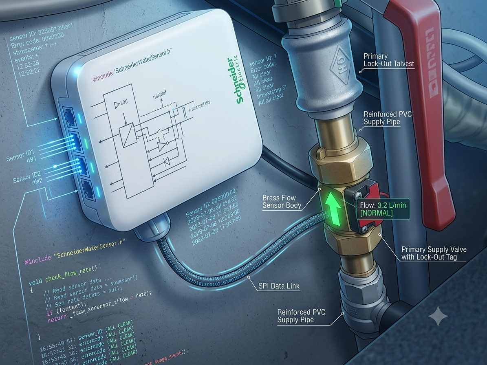

🛠️ Guida Passo-Passo: Contatore Acqua Smart con ESP32-C3 e ESPHome
Questa guida descrive la procedura completa per costruire, programmare e integrare in Home Assistant un contatore dell'acqua smart basato su ESP32-C3 Super Mini e flussimetro a impulsi.

📌 Consigli Preliminari
Browser consigliato: Utilizzare preferibilmente Google Chrome per una gestione stabile della porta seriale USB durante il primo flashing.   

Collegamento hardware: Prima di iniziare qualsiasi operazione software, collegare la schedina ESP32-C3 al PC tramite cavo USB.   

Nota sulla chiave API: Subito dopo aver caricato il codice iniziale (Passaggio 8), ricordarsi di salvare la chiave API (api: key: ...) generata dal sistema. Anche se viene mostrata solo come una sequenza di puntini, sarà indispensabile alla fine della procedura per collegare il dispositivo a Home Assistant.   

📥 Parte 1: Creazione e Primo Flash del Dispositivo (Via USB)
Aprire ESPHome Builder all'interno di Home Assistant.   

Cliccare su + Crea dispositivo.   

Selezionare Crea nuovo progetto.   

Scegliere la famiglia di schede ESP32-C3.   

Scorrere fino a trovare e selezionare ESP32-C3 SUPER MINI.   

Cliccare su Seleziona.   

Inserire il Nome Contatore desiderato.   

Nella configurazione iniziale, inserire i dati della propria rete Wi-Fi:
Riga 24: Inserire il nome della Wi-Fi di casa (ssid).   

Riga 25: Inserire la password della Wi-Fi (password).   

Cliccare su Salva e poi su Installa.   

Scegliere l'opzione Collega a questo computer.   

Attendere il completamento della compilazione del firmware.   

Aprire il programmatore USB.   

Cliccare su Connetti e Installa.   

Selezionare la porta USB corretta e avviare la connessione.   

⚠️ Consiglio fondamentale (Non demordete!): Spesso al primo colpo la scrittura via USB può restituire un errore di compilazione o di connessione seriale. È assolutamente normale con queste schedine. Se accade, non preoccupatevi: scollegate il cavo USB, attendete 5-10 secondi, ricollegatelo e ripetete l'operazione. Basterà insistere un paio di volte e vedrete che la procedura andrà a buon fine.   
JPG

⚙️ Parte 2: Inserimento del Codice YAML Definitivo
Una volta completato il flashing con successo, tornando su ESPHome Builder il sensore risulterà online con la scritta Connesso.   

Cliccare su Modifica sul sensore appena creato.   

Sostituire il codice esistente incollando il codice YAML completo e calibrato riportato qui sotto:   

YAML

captive_portal:

time:
  - platform: sntp
    id: sntp_time

sensor:
  # ==========================================
  # 1. SENSORE DI PORTATA ISTANTANEA (L/min)
  # Misura gli impulsi del flussimetro collegato sul GPIO2
  # ==========================================
  - platform: pulse_counter
    pin: 
      number: GPIO2
      mode:
        input: true
        pullup: true
    state_class: measurement
    name: "Contatore acqua"
    id: Contatore_acqua
    update_interval: 1s
    filters:
      - lambda: return (x / 800.0); # Fattore di calibrazione testato e calibrato sul campo
    unit_of_measurement: "L/min"
    icon: "mdi:water-pump"

  # ==========================================
  # 2. INTEGRATORE PER METRI CUBI (m³)
  # Converte la portata in volume totale accumulato in m³
  # ==========================================
  - platform: integration
    device_class: water
    state_class: total_increasing
    name: "Acqua in m³"
    unit_of_measurement: 'm³'
    accuracy_decimals: 4
    sensor: Contatore_acqua
    time_unit: min
    icon: "mdi:water"
    filters:
      - lambda: return (x / 1000);

  # ==========================================
  # 3. INTEGRATORE PER LITRI TOTALI (L)
  # Converte la portata in litri totali consumati
  # ==========================================
  - platform: integration
    device_class: water
    state_class: total_increasing
    name: "Acqua in litri"
    unit_of_measurement: 'L'
    accuracy_decimals: 1
    sensor: Contatore_acqua
    time_unit: min
    icon: "mdi:water"
    filters:
      - lambda: return (x * 2.7);

text_sensor:
  - platform: wifi_info
    ip_address:
      name: "Indirizzo IP WiFi"
Cliccare su Salva e poi su Installa (scegliendo l'opzione In rete via OTA).   

Attendere il completamento del caricamento wireless e uscire da ESPHome Builder.   

🏠 Parte 3: Integrazione in Home Assistant
Andare nelle Impostazioni di Home Assistant.   

Cliccare su Dispositivi e servizi.   

Cercare l'integrazione ESPHome.   

Entrando nell'integrazione, il nuovo sensore verrà visualizzato automaticamente sotto la voce Rilevato.   

Cliccare su Aggiungi e poi su Invia.   

Verrà richiesto di inserire la API Key del sensore salvata in precedenza.   

Incollare la chiave e cliccare su Avanti.   

Cliccare su Salta e termina.

---
💬 **Supporto e Domande:** Hai domande o problemi con la configurazione? Apri una [Issue](https://github.com/ladysman183/contatore-acqua-smart/issues) oppure cercami su [TikTok](https://www.tiktok.com/@ladysman183)!

